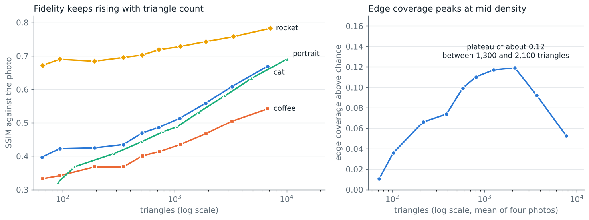

# Parameter study

How each option trades fidelity to the photo against triangle count and edge-following, on the four sample photos. Metrics: [QUALITY_METRICS.md](QUALITY_METRICS.md). By image type and size: [GRID_RATIO_STUDY.md](GRID_RATIO_STUDY.md). Terms such as SSIM, PSNR, edge lift and jitter are defined in the [glossary](CASE_STUDY.md#glossary).

## Result

| Option | Default | Finding |
|---|---|---|
| Grid size | 25 | SSIM rises with every doubling of triangles, with no elbow. Edge-following peaks at 1,300 to 2,100 triangles (grid 16 to 12) with the fixed 12 px jitter; the best grid depends on the jitter rule ([GRID_RATIO_STUDY.md](GRID_RATIO_STUDY.md), section 6). A style choice |
| Canny | 100/200 | Highest edge lift and SSIM of the six settings, but the reference edges are also Canny edges, and the SSIM lead over 50/100 (0.001) is inside seed noise; only 10/20 is clearly worse. Against Sobel and Laplacian-of-Gaussian reference edges 100/200 still ranks first of four settings, with a lead over the runner-up of 0.008 to 0.009 lift, below the 0.02 noise threshold (section 2). Provisional |
| Jitter | 12 | SSIM is flat from 8 to 24 at grid 16. Jitter 0 loses all edge-following. A jitter of half the grid helps only at grids above 25 px, by 0.020 to 0.026 lift (near the noise threshold) |
| Saturation | 1.3 | Fidelity is highest at 1.0 (0.6 is lower) and falls as saturation rises; 1.3 costs 0.044 to 0.050 SSIM against 1.0 on colour photos. A stylistic boost |
| Smoothing | 75 | Gains stop near 75: no optimum between 50 and 150, where settings differ by under 0.002 SSIM |
| Colour mode | centroid | `mean` scores +0.0045 SSIM (inside seed noise) and +1.2 dB over `centroid` on the four photos (section 6) |

Differences under about 0.01 SSIM or 0.3 dB are seed noise when settings are compared across seeds. The quality baseline pins the seed, so its tolerance can be tighter ([BASELINE_REPORT.md](BASELINE_REPORT.md)).

## Method

- **Photos:** the four in `samples/inputs/`, loaded with `max_size=450`. One machine, `scikit-image` 0.26.0.
- **Settings:** defaults (grid 25, jitter 12, Canny 100/200, saturation 1.3, seed 42, centroid colours) except the option under study. Sections 2 to 5 use grid 16 (about 1,250 triangles), so settings are compared at nearly the same triangle count.
- **SSIM:** `structural_similarity(photo, output, channel_axis=2, data_range=255)`. **PSNR:** `peak_signal_noise_ratio(photo, output, data_range=255)`. The output is `Result.to_png()` at scale 1.
- **Edge coverage:** share of the photo's default-Canny edge pixels within 2 px of a mesh edge. **Chance:** share of all pixels within 2 px of a mesh edge. **Lift:** coverage minus chance. **Points on an edge:** share of mesh points on an edge pixel of the run's own edge map.
- Tables show the mean of the four photos. The smoothing study replaces `smooth` with a variant, because bilateral strength is not a package option. The script is not in the repository.

## Seed noise

Twenty seeds per photo:

| Photo | Grid | SSIM mean | SSIM sd | SSIM range | PSNR sd (dB) | PSNR range (dB) | Triangles |
|---|---|---|---|---|---|---|---|
| cat | 40 | 0.431 | 0.0031 | 0.425 to 0.438 | 0.11 | 18.5 to 19.0 | 192 to 192 |
| coffee | 40 | 0.360 | 0.0047 | 0.352 to 0.369 | 0.29 | 14.5 to 15.7 | 192 to 192 |
| portrait | 40 | 0.405 | 0.0059 | 0.396 to 0.417 | 0.22 | 12.8 to 13.5 | 288 to 288 |
| rocket | 40 | 0.690 | 0.0023 | 0.686 to 0.695 | 0.16 | 20.7 to 21.4 | 192 to 192 |
| cat | 16 | 0.511 | 0.0044 | 0.502 to 0.520 | 0.11 | 20.9 to 21.3 | 1093 to 1121 |
| coffee | 16 | 0.435 | 0.0039 | 0.426 to 0.441 | 0.23 | 17.5 to 18.2 | 1120 to 1140 |
| portrait | 16 | 0.531 | 0.0034 | 0.525 to 0.539 | 0.15 | 16.7 to 17.2 | 1628 to 1655 |
| rocket | 16 | 0.725 | 0.0019 | 0.722 to 0.729 | 0.13 | 23.0 to 23.5 | 1117 to 1141 |

SSIM varies with sd 0.002 to 0.006 and PSNR with sd 0.1 to 0.3 dB. Triangle counts vary by about 1% at grid 16 and not at all at grid 40.

## 1. Grid size

| Grid size | Triangles | SSIM | PSNR (dB) | Edge coverage | Chance | Lift | Points on an edge |
|---|---|---|---|---|---|---|---|
| 80 | 72 | 0.431 | 14.9 | 0.24 | 0.23 | +0.01 | 0.32 |
| 60 | 102 | 0.456 | 16.0 | 0.30 | 0.26 | +0.04 | 0.39 |
| 40 | 216 | 0.471 | 16.8 | 0.43 | 0.36 | +0.07 | 0.42 |
| 30 | 388 | 0.485 | 17.7 | 0.54 | 0.47 | +0.07 | 0.46 |
| 24 | 581 | 0.511 | 18.6 | 0.64 | 0.54 | +0.10 | 0.47 |
| 20 | 806 | 0.527 | 19.1 | 0.72 | 0.61 | +0.11 | 0.49 |
| 16 | 1,254 | 0.552 | 19.8 | 0.81 | 0.69 | +0.12 | 0.50 |
| 12 | 2,129 | 0.587 | 20.7 | 0.90 | 0.78 | +0.12 | 0.52 |
| 9 | 3,680 | 0.626 | 21.5 | 0.96 | 0.87 | +0.09 | 0.53 |
| 6 | 7,688 | 0.671 | 22.4 | 0.99 | 0.94 | +0.05 | 0.52 |

Per-photo SSIM:

| Grid size | cat | coffee | portrait | rocket |
|---|---|---|---|---|
| 60 | 0.423 | 0.342 | 0.368 | 0.690 |
| 40 | 0.425 | 0.368 | 0.408 | 0.684 |
| 24 | 0.469 | 0.401 | 0.473 | 0.703 |
| 16 | 0.513 | 0.436 | 0.532 | 0.728 |
| 9 | 0.608 | 0.504 | 0.633 | 0.758 |
| 6 | 0.669 | 0.542 | 0.691 | 0.783 |

- SSIM rises about +0.044 per doubling of triangles above 500 and +0.021 below.
- Edge lift peaks at about +0.12 between 1,300 and 2,100 triangles, then falls: at 7,700 triangles 0.99 of edge pixels are near a mesh edge against a chance level of 0.94.
- Photos differ in level (rocket 0.67 to 0.78, coffee 0.33 to 0.54) but not in trend, so only changes within the same photo are comparable.

## 2. Canny thresholds

| Canny low/high | Triangles | SSIM | PSNR (dB) | Edge coverage | Chance | Lift | Points on an edge |
|---|---|---|---|---|---|---|---|
| 254/255 (very strict) | 1,242 | 0.546 | 19.9 | 0.76 | 0.69 | +0.08 | 0.38 |
| 200/400 | 1,252 | 0.542 | 19.8 | 0.74 | 0.69 | +0.05 | 0.30 |
| 100/200 | 1,254 | 0.552 | 19.8 | 0.81 | 0.69 | +0.12 | 0.50 |
| 50/100 | 1,263 | 0.551 | 19.6 | 0.77 | 0.69 | +0.08 | 0.65 |
| 25/50 | 1,268 | 0.548 | 19.5 | 0.74 | 0.69 | +0.04 | 0.72 |
| 10/20 | 1,271 | 0.531 | 19.2 | 0.73 | 0.70 | +0.03 | 0.78 |

- 100/200 has the highest SSIM (0.552) and the highest lift (+0.12), but its SSIM lead over 50/100 (0.551) is inside seed noise, and the lift is measured against the photo's own default-Canny edges, so the default scores against its own output.
- Looser thresholds put more points on edges (0.50 up to 0.78) but fidelity and lift fall; at 10/20 SSIM is 0.021 lower and lift +0.03.
- Stricter thresholds also lose lift. The SSIM differences between 50/100 and 254/255 are within noise.

**Against non-Canny reference edges.** `python scripts/canny_reference.py` scores four settings (25/50 to 200/400) against three reference edge maps of the same photos, each with the edge count of Canny 100/200: Canny 100/200 itself (the circular control), Sobel magnitude thinned to one pixel, and Laplacian-of-Gaussian zero crossings (sigma 2, strongest pixels). Four photos, 384 px, 16 cells across (grid 24 px), jitter 12, seeds 0 to 2. Mean edge lift:

| Reference edges | 25/50 | 50/100 | 100/200 | 200/400 | Best | Lead over the runner-up |
|---|---|---|---|---|---|---|
| Canny 100/200 | 0.0430 | 0.0662 | 0.1107 | 0.0679 | 100/200 | 0.043 |
| Sobel | 0.0364 | 0.0565 | 0.0641 | 0.0330 | 100/200 | 0.008 |
| Laplacian of Gaussian | 0.0385 | 0.0577 | 0.0670 | 0.0450 | 100/200 | 0.009 |

A wider run on 25 images (these four and the 21 photos of `samples/study/`) gave the same order, with leads of 0.007 (Sobel) and 0.010 (Laplacian of Gaussian). So 100/200 ranks first on every reference, but against edges that are not Canny edges its lead is below the 0.02 noise threshold. Sobel and Laplacian of Gaussian are also gradient-based, so they are not fully independent; human-drawn boundaries (BSDS500, `--bsds`) were not run. 10/20 and 254/255 were not part of this comparison.

## 3. Jitter

| Jitter | Triangles | SSIM | PSNR (dB) | Edge coverage | Chance | Lift | Points on an edge |
|---|---|---|---|---|---|---|---|
| 0 | 1,289 | 0.538 | 19.4 | 0.74 | 0.73 | +0.01 | 0.07 |
| 4 | 1,283 | 0.547 | 19.8 | 0.77 | 0.73 | +0.04 | 0.31 |
| 8 | 1,282 | 0.557 | 20.0 | 0.81 | 0.71 | +0.09 | 0.43 |
| 12 | 1,254 | 0.552 | 19.8 | 0.81 | 0.69 | +0.12 | 0.50 |
| 16 | 1,253 | 0.553 | 19.8 | 0.82 | 0.67 | +0.15 | 0.58 |
| 24 | 1,234 | 0.550 | 19.9 | 0.84 | 0.65 | +0.19 | 0.65 |

- SSIM is flat from jitter 8 to 24. Jitter 0 loses about 0.014 SSIM and all edge lift, because points cannot reach an edge.
- Edge lift keeps rising with jitter (+0.09 at 8 to +0.19 at 24) while the triangle count falls (1,282 to 1,234): above half the grid size, neighbouring cells search the same pixels and snap to the same point, so points merge.

## 4. Saturation

| Saturation | SSIM | PSNR (dB) |
|---|---|---|
| 1.0 | 0.602 | 21.2 |
| 1.15 | 0.576 | 20.8 |
| 1.3 | 0.552 | 19.8 |
| 1.5 | 0.518 | 18.6 |
| 1.8 | 0.478 | 17.2 |

Fidelity falls steadily as saturation rises; 1.0 is the most faithful of the values tested here.

A later run (`python scripts/colour_options.py`; 384 px, 16 cells across, jitter 12, seeds 0 to 2, colour images only) added values below 1.0 and compares each setting with the default 1.3. SSIM difference, mean over images (images higher than the default):

| Saturation | Four photos | 25 colour images |
|---|---|---|
| 0.6 | +0.0100 (4 of 4) | +0.0091 (21 of 25) |
| 1.0 | +0.0441 (4 of 4) | +0.0332 (25 of 25) |
| 1.3 | 0 | 0 |
| 1.6 | -0.0455 | -0.0329 |
| 2.0 | -0.0818 | -0.0568 |

Fidelity peaks at 1.0: 0.6 is 0.034 below it on the four photos. Values between 0.6 and 1.0 were not tested. The 25 images are the four photos and the 21 photos of `samples/study/`; none is greyscale.

## 5. Smoothing strength

Not a package option; the filter was replaced in the study script.

| Bilateral sigma (0 = no filter) | SSIM | PSNR (dB) |
|---|---|---|
| 0 | 0.538 | 19.5 |
| 25 | 0.547 | 19.6 |
| 75 | 0.552 | 19.8 |
| 150 | 0.553 | 20.0 |

Sigma 75 gains +0.014 SSIM and +0.37 dB over no filter; sigma 150 adds +0.001 SSIM and +0.19 dB more. The window size (d=9) was not varied.

The same later run (`colour_options.py`) gives the SSIM difference against sigma 75, mean over images:

| Sigma | Four photos | 25 colour images |
|---|---|---|
| 0 (no filter) | -0.0117 | -0.0110 |
| 25 | -0.0045 | -0.0044 |
| 50 | -0.0013 | -0.0015 |
| 75 | 0 | 0 |
| 100 | +0.0006 | +0.0009 |
| 150 | +0.0009 | +0.0017 |

SSIM rises with sigma with no optimum in the range, and from 50 upwards the settings differ by under 0.002, inside seed noise (sd 0.002 to 0.006). 75 is on the plateau; it is not shown to be the best value.

## 6. Colour mode

`centroid` takes each triangle's colour from the pixel at its centre; `mean` averages the triangle's pixels. Same later run, difference of `mean` over `centroid`:

| Images | SSIM | PSNR (dB) | Images higher (SSIM) |
|---|---|---|---|
| Four photos | +0.0045 | +1.20 | 3 of 4 |
| 25 colour images | +0.0070 | +1.25 | 21 of 25 |

The PSNR gain is about 1.2 dB; the SSIM gain is inside seed noise. The run time of the two modes was not measured in this run, so the cost of `mean` is unknown.

## Limits

- Sections 1 to 5: four photos, one size, one seed per setting. None has text or thin lines. The later runs (Canny reference, saturation, smoothing, colour mode) use three seeds and 384 px.
- Grid labels: "grid 16" is 16 px between points; "16 cells" is 16 cells across the long side. At 450 px, grid 16 and 12 are 28 and 38 cells across. With the package's fixed 12 px jitter the best grid is about 16 px in both studies (section 1 here: 16 to 12 px; [GRID_RATIO_STUDY.md](GRID_RATIO_STUDY.md) section 6: 16 px at 384 and 512 px). The 16 cells in that study's headline is for jitter at half the grid, which is why the two peaks differ in cells.
- The jitter is a fixed 12 px except in section 3. At grid 16 that is 0.75 of the grid, so the grid-size results hold for that ratio; with jitter at half the grid the best grid moves to about 24 px.
- Fidelity to the photo is not appeal.