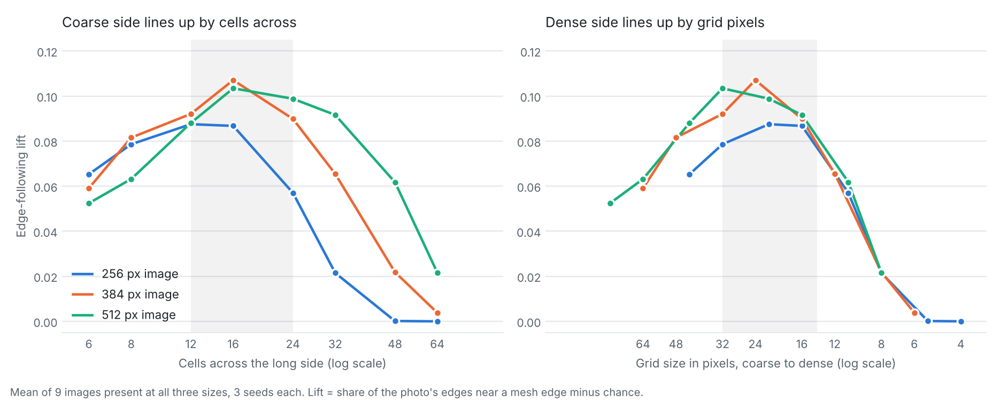
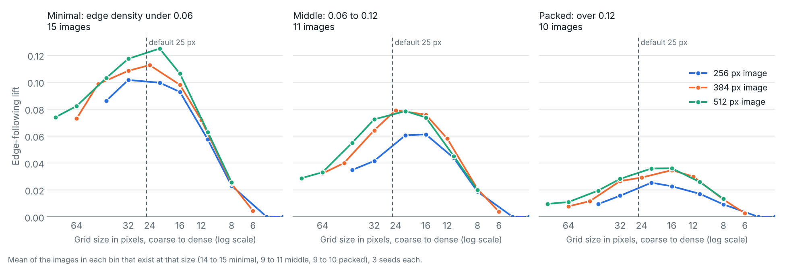
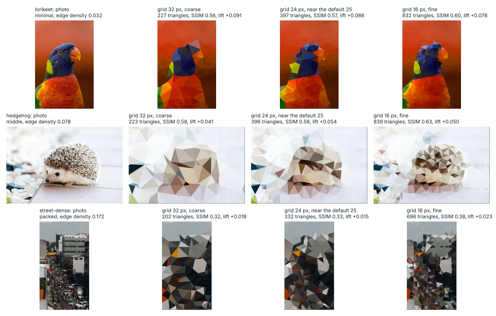

# Checking Low-Poly Output Quality Without an Answer Key

## Abstract

`low-poly-generator` (Python package `lowpoly`) turns a photo into flat-coloured triangles. Many outputs are acceptable and none is the single correct one, so tests cannot compare against an expected image (the test oracle problem). This study measures how large run-to-run noise is, which quality checks detect known faults, and, as a by-product, which grid size and settings best follow a photo's structure.

Results: seed-to-seed variation (standard deviation) reaches 0.006 SSIM and 0.3 dB; no fixed pass mark works (SSIM 0.32–0.78 across the four sample photos); the baseline at 0.005 SSIM / 0.1 dB caught all injected faults and tested sizes in the author-selected set (not a general effectiveness estimate); with the jitter at half the grid, edge-following peaks at about 16 cells across the long side for every image type tested (animal and graphic have one image each), and with the package's fixed jitter of 12 px the best grid is 16 px. The shortest route, a golden baseline validated by fault injection, is where the study ended up; the appendices give the calibration for the tool's defaults and the journey with its lessons. No people rated the images.

## Intent and status

**Intent:** decide which image-quality checks `lowpoly` needs, from measurements instead of looking at outputs. Along the way the study measured which settings follow the photo best; that part is [Appendix A](#appendix-a-calibration-tuning-the-defaults). How the work unfolded, and what it taught, is [Appendix B](#appendix-b-the-journey). The existing exact tests and the ten metamorphic tests stay alongside the baseline; how the kinds of test fit together is in the [testing strategy](../TESTING.md).

**Status: exploratory.** No hypotheses were set beforehand.

| State                   | What                                                                                                                                                                                                                                                                                                                                                                                                                                                                                 |
|-------------------------|--------------------------------------------------------------------------------------------------------------------------------------------------------------------------------------------------------------------------------------------------------------------------------------------------------------------------------------------------------------------------------------------------------------------------------------------------------------------------------------|
| **Built**               | The baseline check (`tests/test_quality_baseline.py`), validated by injecting 21 changes ([baseline report](BASELINE_REPORT.md)). The baseline runs in every CI environment and fails the build when a score drifts; CI also uploads the scores of every run. Ten metamorphic tests on the mesh and the relief shading (`tests/test_metamorphic.py`; no scores involved) |
| **Measured**            | Noise floor of the quality measures; detection of known faults; grid-size sweeps over 14 images, 7 types and 3 sizes, then over 36 images by edge density; ranking of four parameters; a jitter check; grid size under two jitter rules                                                                                                                                                                                                                                              |
| **Proposed, not built** | Five further checks: colour options leave the mesh alone, jitter 0 stops edge snapping, the quality measures detect damage, relation checks between photos and grid sizes, and saturation changes the colours. The test suite as a whole is described in the [testing strategy](TESTING.md)                                                                                                                                                                                                                                                                                                                                                                                                                                         |
| **Not done**            | A human preference comparison; the parameter study scripts are not committed (the grid sweep, `scripts/grid_sweep.py`, is). The package defaults are unchanged                                                                                                                                                                                                                                                                                                                       |
| **How far to trust it** | Image-quality and calibration measurements use these images and one machine; platform spread was measured separately on nine CI environments. The injected faults were chosen by the author, so the detection rate is not a general estimate                                                                                                                                                                                                                                         |

## Context

`lowpoly` turns a photo into an image made from flat-coloured triangles. Triangle size changes the style, so there is no single correct output. Before this work the four bundled sample outputs were judged by looking at them. The rest of the test suite checks program behaviour, such as valid geometry and reliable files ([testing strategy](../TESTING.md)).

### The test oracle problem

A test needs a way to decide whether a result is correct. That mechanism is the **test oracle**; the simplest oracle is an expected value. The **test oracle problem** is the case where no expected value exists or can be had cheaply (Weyuker, 1982, calls such programs "non-testable"; Barr et al., 2015, survey the sources of oracle information).

`lowpoly` is such a program: point placement is random, many triangle meshes are acceptable for one photo, and whether an output looks good is a human judgement. A mesh can be valid and repeatable and still look wrong. A test has to use a weaker, partial oracle:

| Partial oracle                     | Question it answers                                                                | Used here         |
|------------------------------------|------------------------------------------------------------------------------------|-------------------|
| **Rules every output must obey**   | Is the mesh valid (tiles the image, Delaunay empty-circle rule, colours in range)? | Property tests    |
| **A trusted reference version**    | Does the output match the original script?                                         | Differential test |
| **Known input-output relations**   | If the input changes in a known way, does the output change as expected?           | Metamorphic tests |
| **Similarity to the source photo** | Does a fault move the score beyond noise?                                          | Baseline check    |
| **Human judgement**                | Which output do people prefer?                                                     | Not done          |

### Related work

- **Golden-image tests.** Graphics projects keep reviewed reference images and compare new output with them. Chromium's Gold matches exactly by default, makes tolerance opt-in and warns that it can let a faulty image pass, requires a person to approve new images, and keeps several approved images per test for platform differences (Chromium). Flutter reviews updated reference images in the pull request (Flutter). The baseline check follows this pattern with stored scores instead of stored images.
- **Metamorphic testing.** Chen et al. (2018) review the technique. For image-processing programs, Mayer and Guderlei (2006) and Guderlei and Mayer (2007) study which relations detect injected faults, and Just and Schweiggert (2011) show with mutation analysis that partial oracles test part of a JPEG2000 encoder and differ between unit and integration level. Segura et al. (2016) survey the field and note that how well a relation works depends on its choice.
- **Fault injection.** Changing code on purpose to see whether tests notice is mutation analysis (Jia and Harman, 2011). Just et al. (2014) found that detecting mutants goes with detecting real faults, but that some real faults are not coupled to any mutant, so the injected set is a proxy.
- **Measures.** SSIM is from Wang et al. (2004). Edge lift is boundary recall with a 2 px tolerance, as used for superpixel evaluation (arXiv:1903.07162), with the chance level subtracted. Boundary recall ignores how many boundaries a mesh has, so the superpixel literature reports it with contour density.
- **Rendering evaluation.** Gatzidis et al. (2008) survey user-evaluation studies of non-photorealistic rendering.

None of this is new. The study adds what is project-specific: the noise floor of the measures, the smallest fault each check detects, and the validation by fault injection. Learned image metrics (LPIPS, Zhang et al., 2018; DISTS, Ding et al., 2022) were not reviewed or compared.

**The shortest route** would have been a golden baseline and a few metamorphic tests, validated with injected faults. That is where the study ended up; [Appendix B](#appendix-b-the-journey) shows how it got there and what the detour added.

## Outcome

### Detection

- Repeated runs with different seeds vary (standard deviation over 20 seeds) by 0.002 to 0.006 SSIM and 0.1 to 0.3 dB PSNR, so smaller differences are not real.
- Large faults (wrong photo, shifted output) moved both scores. Small faults (darker colours, a blackened border row) barely moved SSIM but showed in PSNR, so both measures are needed.
- SSIM against the source ranged from 0.32 to 0.78 across the settings of the four sample photos, and from 0.09 to 0.89 per image (mean of three seeds) across 36 images at 384 px and 16 cells across, so no fixed pass mark such as 0.85 can work. Comparisons can: at grid 16 each photo's output scored 0.17 to 0.45 higher against its own source than against the best of the other three photos, and a margin of 0.10 holds for these four photos.
- At the original tolerances (0.01 SSIM / 0.3 dB), the baseline caught 9 of 9 faults in the author-selected set but missed colours 1 level darker and 1 and 2 px shifts. The current tolerances (0.005 / 0.1 dB) catch every injected fault and tested size in a run of the validation script at that tolerance; this remains validation of a selected set, not a general effectiveness estimate. One of two harmless changes is flagged (a new seed, PSNR +0.32 dB and -0.11 dB); the other, a smaller bilateral window, passes by 0.001 SSIM and 0.02 dB. The tolerances fall inside the seed-noise range (0.005 SSIM against 0.002–0.006; 0.1 dB against 0.1–0.3 dB), so they are valid only with pinned seeds, and a change to random-number use or library versions can trip them. They were tightened after misses on this set, and the smallest sizes are caught with thin margins (1 level darker at 1.9 times the tolerance, a 1 px shift at 1.4 times).
- Fixed-seed runs repeat exactly on one machine. A one-time comparison across nine CI environments found at most 0.0007 SSIM and 0.02 dB of platform spread (Linux, Windows and Intel macOS match the stored baseline scores exactly, at 4 decimals for SSIM and 2 for dB; Apple silicon differs slightly), 7 and 5 times below the current tolerances.

### Calibration ([Appendix A](#appendix-a-calibration-tuning-the-defaults))

- With the jitter at half the grid, edge lift peaks at about 16 cells across the long side for every image type tested, and the default grid of 25 is in the best band for 384 and 512 px images. With the package's fixed jitter of 12 px the best grid is 16 px at both sizes, and 24 px is 16% and 13% lower.
- With half-grid jitter, busier images want a finer grid. Across 36 images binned by edge density, the grid within 90% of the peak is 24 to 32 px for sparse images and 16 to 24 px for middle ones, and at 384 px 16 px only for packed ones; at 384 px the default sits about 16% (0.0055) below the packed peak, a gap within noise. With the fixed jitter every bin peaks at 12 to 16 px.
- Jitter has the largest effect on point placement, then Canny thresholds. Smoothing 75 is on a plateau (50 to 150 differ by under 0.002 SSIM) and Canny 100/200 is provisional (it ranks first against Sobel and Laplacian-of-Gaussian reference edges too, but its lead there is inside noise). A jitter of `max(12, grid / 2)` equals the default up to 25 px and adds 0.020 lift at 40 px, near the noise threshold.

**Not established:** which output people prefer. SSIM generally rises with density, though not monotonically between close coarse grids, so similarity cannot choose a density, and edge-following is not appeal.

## Key stages

1.  **Measure noise and known faults.** Each of the four sample photos was generated with 20 seeds at two grid sizes. With settings unchanged, the standard deviation was 0.002 to 0.006 for SSIM and 0.1 to 0.3 dB for PSNR. Then one cat output was damaged in known ways:

    | Change to output                  | SSIM change | PSNR change |
    |-----------------------------------|-------------|-------------|
    | Used a different photo            | -0.310      | -10.43 dB   |
    | Shifted output by 6 pixels        | -0.069      | -1.78 dB    |
    | Made colours 20% darker           | -0.008      | -4.05 dB    |
    | Blackened the last row and column | -0.001      | -0.61 dB    |

    **Table 1.** Effect of known faults on one cat output.

    Large faults moved both scores; small brightness and border faults barely moved SSIM (−0.001 to −0.008) and showed in PSNR (−0.6 to −4 dB). A check catches the small faults only with a tolerance under 0.6 dB.

2.  **Prefer relative checks to absolute ones.** SSIM against the source spans 0.32 to 0.78 across the settings of the four sample photos, because a coarser mesh scores lower by design. A pass mark would reject good coarse output or accept bad dense output. A stored reference per photo and setting avoids this.

3.  **Build the baseline.** Stored scores for the four sample photos at two settings (default, grid 16) became a test with two-sided tolerances of 0.005 SSIM and 0.1 dB. Updating the scores is a reviewed change. The tolerances fall inside the seed-noise range, so seeds are pinned.

4.  **Validate it by fault injection.** 21 changes (9 faults, 10 sizes of three faults, 2 harmless changes) were injected one at a time into a copy of the code. At the current tolerance, the baseline catches every injected fault and tested size (from a run of the validation script at that tolerance). The existing tests other than the differential test (example, property and metamorphic tests) caught 3 of the 9 faults; the differential test caught every change, harmless ones included, so it cannot tell a fault from an intended change. The baseline tolerated one of the two harmless changes and flagged the other, so its separation rests on two cases; the smallest fault it caught changes PSNR by only 0.06 dB more than the tolerated change ([baseline report](../docs/BASELINE_REPORT.md)).

5.  **Try metamorphic relations.** A prototype of three relations (colour options leave the mesh alone, jitter 0 stops edge snapping, and the photo and grid-size comparisons; not in the repository, so not reproducible) caught 6 of 12 injected faults (the list of 12 is not defined here), all of which the baseline also caught. It adds no detection; whether it helps diagnose a fault (colour or mesh) was not measured.

## Impact

The study gives two measured answers: how large run-to-run noise is and which faults it hides, and which grid size and jitter follow the photo's edges best, with effects near the noise level, not adopted. The quality baseline is built and fails the CI run. No people rated the images, and no user impact was measured.

### Evidence and reproducibility

- First study: the four photos in `samples/inputs/` at 450 px, one seed per setting except the 20-seed noise runs. Broader study: 14 scikit-image images, sizes up to 512 px apart from one image at 800 px, three seeds per setting, five for the jitter check. Complexity study: 36 images (21 CC0 photos from Pexels, 15 library samples; the synthetic colour wheel is left out), 36 images at 256 and 384 px and 32 at 512 px (images are not enlarged), three seeds. Seed 42 is the default.
- Image-quality and calibration measurements on one machine, with `scikit-image` 0.26.0 (a test dependency, not a package dependency); platform spread was measured separately across nine CI environments. The baseline test, its update script and the fault-injection script are in the repository (`tests/`, `scripts/`); the grid sweeps (`scripts/grid_sweep.py` with `docs/grid_sweep.csv`, and `scripts/grid_jitter.py` with `docs/grid_jitter.csv`) are; the parameter study scripts are not.
- Not measured: CI flake rate, the effort of updating the baseline, and user impact.
- Detection at 0.005 SSIM / 0.1 dB comes from a single run of the validation script at that tolerance. An earlier output of the same script showed the three smallest sizes as missed, which matches the earlier 0.01 / 0.3 dB tolerance.

## Learnings & status

- Measure the normal variation and test known faults before using a score to flag changes. SSIM and PSNR catch different errors.
- Validate a check by injecting faults before trusting it. The injected faults showed which checks add detection and which do not.
- A rise in a score can be a fault: a baseline has to fail in both directions.
- A stored reference with reviewed updates (the golden-image pattern) caught its whole injected set; the relation prototype caught 6 of a different, undefined 12.
- Match the evidence to the claim: numeric stability needs platform data, appeal needs people.

Current status: the baseline fails the CI run at 0.005 SSIM / 0.1 dB. Five further checks remain proposed, not implemented. No human preference comparison was conducted, so the study makes no claim about appeal.

### Objections and responses

| Objection                                                                    | Status           | Response                                                                                                                                                                                                                                                                                                                                                             |
|------------------------------------------------------------------------------|------------------|----------------------------------------------------------------------------------------------------------------------------------------------------------------------------------------------------------------------------------------------------------------------------------------------------------------------------------------------------------------------|
| **Nothing is implemented, so the study guards nothing**                      | Partly addressed | The baseline is built, validated on an author-selected set of 21 changes, and fails the CI run at 0.005 SSIM / 0.1 dB. The measured platform spread is 7 and 5 times below those tolerances.                                                                                                                                                                         |
| **Edge following is not appeal; "optimal density" is a plateau of a metric** | Deferred         | Stated as a limit. No human preference comparison was conducted; the regression checks do not use edge lift or the grid and jitter results.                                                                                                                                                                                                                          |
| **14 images is too few; the tolerances overfit**                             | Partly addressed | The baseline covers the four sample photos only and makes no claim about others. The tolerances are set against the seed noise floor and the platform spread, not the 14 images, and were tightened after misses on the injected set. The grid and jitter guidance rests on 14 images, extended to 36 for the grid by edge density, and is labelled a starting point |
| **A numeric failure says something drifted, not what**                       | Partly addressed | A failure names the photo, setting, metric, direction and size; a swapped channel moves PSNR by 5 to 10 dB, mesh faults by 0.1 to 3 dB. The relation checks are not implemented.                                                                                                                                                                              |

## Appendix A: Calibration, tuning the defaults

### How it helps tune the defaults

The study measured how the mesh follows the photo as each setting changes. That gives three things for choosing defaults:

1.  **A rule for what counts as a real change.** Compare settings at the same triangle count, with at least 3 seeds, and read a difference as real only above the noise: about 0.01 SSIM or 0.02 edge lift when settings are compared across seeds (the baseline pins seeds, so its tolerance is tighter).
2.  **A measure that can choose.** SSIM and PSNR generally rise with density, though not monotonically between close coarse grids, so they cannot choose a density. Edge lift peaks, so it can.
3.  **A guard for the result.** The baseline's "default" scores use the package defaults. A changed default moves those scores, so the update is a reviewed change, and the noise floor says whether the move is real.

[The table at the end of this appendix](#from-findings-to-defaults) turns the findings into a suggestion per default.

### Method

"Best" grid size is the grid where the mesh follows the photo's edges most (edge lift), because SSIM and PSNR generally rise with density. Other parameters are compared at a fixed grid size, so density cannot explain an effect. The study covered 14 images bundled with scikit-image (portrait, animal, object, texture, text, sky, graphic; one is a synthetic colour wheel) at long sides of 256, 384 and 512 px, with grid size set as cells across the long side N = 6 to 64. A second sweep added 23 images (21 CC0 photos in `samples/study/`, two scikit-learn samples) and grouped all by edge density, leaving out the colour wheel (36 images). Both sweeps set the jitter to half the grid; the package default is a fixed 12 px, which is checked separately below. Detail and tables: [grid size by image type, size and complexity](../docs/GRID_RATIO_STUDY.md) and [parameter study](../docs/PARAMETER_STUDY.md).

The four-photo study first showed the shape: SSIM kept rising with density, while edge lift peaked.

| Grid size | Approx. triangles | SSIM  | Edge lift |
|-----------|-------------------|-------|-----------|
| 40 px     | 216               | 0.471 | +0.07     |
| 24 px     | 581               | 0.511 | +0.10     |
| 16 px     | 1,254             | 0.552 | +0.12     |
| 12 px     | 2,129             | 0.587 | +0.12     |
| 9 px      | 3,680             | 0.626 | +0.09     |
| 6 px      | 7,688             | 0.671 | +0.05     |

**Table 2.** Fidelity and edge lift by grid size, mean of four photos at 450 px, with the default jitter (12 px).

*Figure 1. Left: SSIM for each of the four sample photos. Right: edge-lift average across those photos. 450 px images, one seed per setting.*

### Grid size by image type and size

- **By type** (jitter at half the grid): the peak is at N = 16 for every type; types differ in level, not position (sky 0.156, texture 0.047). Within 90% of the peak, N is 16 only for portrait and texture, 16 to 24 for animal, 8 to 16 for object and 12 to 24 for text and sky.
- **By size** (jitter at half the grid): the peak is at N = 12 to 16 at 256 px, 16 at 384 px and 16 to 24 at 512 px. The coarse side of the curve follows cells across; the dense side follows grid pixels.

*Figure 2. Each point averages the nine images that are at least 512 px on the long side, and three seeds; jitter at half the grid.*

| Long side | Grid size that follows edges best (px) | Cells across | Typical best   |
|-----------|----------------------------------------|--------------|----------------|
| 256 px    | 14 to 21                               | 12 to 18     | about 20       |
| 384 px    | 16 to 32                               | 12 to 24     | about 24       |
| 512 px    | 21 to 32                               | 16 to 24     | about 24 to 28 |

At N = 12 to 24 the triangle count runs from about 150 to 1,250, depending on the image.

The contact sheet shows what the numbers leave out. At 48 px the astronaut and coffee are hard to recognise. At 24 px all three subjects read clearly as low-poly. At 12 px more detail returns and the images are closer to their photos.

*Figure 3. Three examples at 384 px. Labels show triangle count and SSIM against the source. 24 px is the coarsest of these where every subject stays recognisable; 12 px is more faithful.*

### Parameters by effect

At a fixed grid size (N = 16 and 32, 384 px, 13 images). Effect is the difference between the best and worst tested value. Ranked by the edge-lift effect, then by the SSIM effect: only the parameters that move points change lift. By SSIM the order is jitter, smoothing, saturation, Canny; by PSNR it is smoothing, then jitter and Canny, then saturation. The ranking depends on the value ranges chosen.

| Rank | Parameter              | Values                          | SSIM effect (N=16 / 32) | PSNR effect, dB | Lift effect (N=16 / 32) | Changes |
|------|------------------------|---------------------------------|-------------------------|-----------------|-------------------------|---------|
| 1    | Jitter (share of grid) | 0, 0.25, 0.5, 0.75, 1.0         | 0.029 / 0.027           | 0.5 / 0.6       | **0.138 / 0.109**       | Points  |
| 2    | Canny low/high         | 25/50, 50/100, 100/200, 200/400 | 0.009 / 0.013           | 0.4 / 0.6       | 0.061 / 0.036           | Points  |
| 3    | Smoothing (sigma)      | 0, 75, 150                      | 0.015 / 0.021           | 0.7 / 0.9       | 0                       | Colours |
| 4    | Saturation             | 1.0, 1.15, 1.3                  | 0.014 / 0.017           | 0.3 / 0.5       | 0                       | Colours |

For scale, going from N=8 to N=32 moves the mean SSIM by 0.124, so for SSIM grid size outweighs every other setting. Eight of the 13 images are greyscale, which smoothing and saturation cannot change, so their effects are understated for colour photos: on colour images only (384 px, 16 cells across, jitter 12) saturation 1.3 costs 0.044 SSIM against 1.0 on the four photos and 0.033 on 25 colour photos, and smoothing sigma 50 to 150 differ by under 0.002.

**Jitter check.** Paired runs on 13 images at 384 px, 5 seeds each; only the jitter differs. Differences are half-grid jitter minus the default 12 px, mean over images; the count is images with a higher value.

| Grid (px) | Jitter, default / half grid | Lift difference (images higher) | SSIM difference (images higher) |
|-----------|-----------------------------|---------------------------------|---------------------------------|
| 12        | 12 / 6                      | -0.042 (0 of 13)                | -0.002 (9 of 13)                |
| 16        | 12 / 8                      | -0.022 (1 of 13)                | +0.001 (7 of 13)                |
| 25        | 12 / 12                     | 0                               | 0                               |
| 40        | 12 / 20                     | +0.020 (11 of 13)               | +0.001 (7 of 13)                |
| 60        | 12 / 30                     | +0.026 (10 of 13)               | +0.005 (12 of 13)               |

At fine grids a fixed 12 px is already 0.75 to 1.0 of the grid, and halving it lowers lift. At coarse grids it is 0.3 or less and half the grid helps. `max(12, grid / 2)` equals the default up to 25 px and adds 0.020 lift at 40 px and 0.026 at 60 px, near the 0.02 noise threshold, with SSIM +0.001 and +0.005.

### Jitter rule and grid size

The sweeps above set the jitter to half the grid. The package default is a fixed 12 px, which at fine grids is 0.75 to 1.0 of the grid and snaps more points to edges. The same images (36 at 384 px, 32 at 512 px, three seeds) were run with both rules (`scripts/grid_jitter.py`). Mean edge lift:

| Image size | Jitter          | 40 px | 32 px | 24 px     | 16 px     | 12 px |
|------------|-----------------|-------|-------|-----------|-----------|-------|
| 384 px     | 12 px (default) | 0.041 | 0.060 | 0.079     | **0.095** | 0.092 |
| 384 px     | Half the grid   | 0.064 | 0.072 | **0.079** | 0.074     | 0.056 |
| 512 px     | 12 px (default) | 0.046 | 0.066 | 0.084     | **0.097** | 0.093 |
| 512 px     | Half the grid   | 0.073 | 0.080 | **0.084** | 0.077     | 0.058 |

**Table 3.** Mean edge lift by grid size and jitter rule.

With half-grid jitter the best grid is 24 px; with the default 12 px it is 16 px at both sizes. At 25 px both rules use a jitter of 12 and agree, so the current grid default is best under `max(12, grid / 2)` and 16 px is best under the fixed default. Under the fixed default, 16 px is the best grid or within 0.006 of it in all three density bins at both sizes. Against 24 px it adds 0.016 lift at 384 px (16%) and 0.013 at 512 px (13%), near the 0.02 noise threshold, for about twice the triangles. 256 px images were not tested with the fixed jitter.

**Grid labels.** "16 px" is the spacing between points and "16 cells" is the number of cells across the long side; at 450 px a 16 px grid is 28 cells across and a 12 px grid 38. With the fixed 12 px jitter the best grid is about 16 px in the four-photo study (16 to 12 px at 450 px) and in the 36-image study (16 px at 384 and 512 px). The 16 cells in the headline is for jitter at half the grid, which is why the two peaks differ in cells.

### Grid size by image complexity

Complexity is the share of pixels that are Canny edges at 384 px (edge density). 36 images (the colour wheel left out), same sizes and settings, jitter at half the grid. Minimal images peak at coarser grids; middle and packed images share one band, and the packed peak is within noise.

| Bin (edge density)    | Images | Best N | Within 90% (N) | Best grid at 384 px | Within 90% at 384 px | Peak lift | SSIM at N=16 |
|-----------------------|--------|--------|----------------|---------------------|----------------------|-----------|--------------|
| Minimal (\<0.06)      | 15     | 16     | 12 to 16       | 24 px               | 24 to 32 px          | 0.107     | 0.660        |
| Middle (0.06 to 0.12) | 11     | 16     | 16 to 24       | 24 px               | 16 to 24 px          | 0.071     | 0.510        |
| Packed (\>0.12)       | 10     | 24     | 16 to 24       | 16 px               | 16 px                | 0.029     | 0.271        |

- Density moves the level much more than the position: peak lift falls from 0.107 to 0.029 and SSIM from 0.66 to 0.27 (both pooled over 256, 384 and 512 px images), while the best N moves from 16 to 24. Across images the rank correlation of density with peak lift is -0.76 and with the best N +0.60 (pooled over sizes).
- At 384 px, packed images are best at 16 px and stay within 90% of their peak only at 16 px. The default of 25 is in the band for sparse images, at the coarse edge for middle ones, and about 16% below the peak lift for packed ones at 384 px, a gap of about 0.0055, within noise.

*Figure 4. Edge lift against grid size for the three density bins. The dashed line is the default 25 px. At 384 px packed images peak at 16 px, stay within 90% only at 16 px, and reach less than a third of the lift of minimal ones.*

*Figure 5. One photo per bin at 384 px, jitter at half the grid. The lorikeet and hedgehog stay readable at 24 px; the packed street scene is not readable at any of the three grids (SSIM 0.32 to 0.38).*

- Per image, 22 of 36 keep at least 90% of their own peak at N=16. Texture-like images (gravel, fern, grass) peak under 0.01 lift, which is noise; they are different images from the texture type above (peak 0.047).

### From findings to defaults

| Setting      | Default now | What the study found                                                                                                                                                                                                                                              | Suggestion                                                    | Status                                                                                                           |
|--------------|-------------|-------------------------------------------------------------------------------------------------------------------------------------------------------------------------------------------------------------------------------------------------------------------|---------------------------------------------------------------|------------------------------------------------------------------------------------------------------------------|
| `grid_size`  | 25          | With the fixed jitter of 12 px, edge lift is highest at 16 px at 384 and 512 px; 24 px is 16% and 13% lower. With half-grid jitter the best is 24 px, about 16 cells across, and 25 px is in the best band                                                        | 16 px; 256 px images were not tested with the fixed jitter    | Not adopted                                                                                                      |
| `jitter`     | 12 (fixed)  | `max(12, grid / 2)` equals the default up to 25 px; at 40 and 60 px it adds 0.020 and 0.026 lift (near the 0.02 noise threshold); SSIM changes by at most 0.005                                                                                                   | `max(12, grid / 2)`; equals the default at 16 px and at 25 px | Not adopted                                                                                                      |
| Canny        | 100/200     | Highest edge lift at 256, 384 and 512 px against Canny reference edges, so the test is partly circular; first against Sobel and Laplacian-of-Gaussian edges on four photos, with a lead of 0.008 to 0.009 lift over the runner-up, below the 0.02 noise threshold | Keep                                                          | Provisional                                                                                                      |
| Smoothing    | 75          | +0.013 SSIM (N=16) and +0.021 (N=32) over no filter; 150 adds at most 0.002                                                                                                                                                                                       | Keep                                                          | On a plateau from 50 to 150 (under 0.002 SSIM apart); the N=16 effect over no filter is near the noise threshold |
| `saturation` | 1.3         | Costs 0.014 to 0.017 SSIM against 1.0 on the 13-image mean (8 greyscale); 0.044 on the four colour photos and 0.033 on 25 colour photos                                                                                                                           | 1.0 for fidelity, 1.3 for a stronger look                     | Unchanged, a style choice                                                                                        |

### Limits

- The type study used fourteen images, one to three per type; animal and graphic have one each, so per-type rows are indications. Eight are grayscale, which raises their SSIM and PSNR. The complexity study has 36 images with no type labels, in bins of 10 to 15.
- Sizes stop at 512 px apart from one image at 800 px.
- The grid sweeps set the jitter to half the grid; the check with the package's fixed 12 px covers 384 and 512 px only.
- The 2 px tolerance of edge lift shapes the dense side of every curve, and the reference edges depend on image size.
- Edge density is one measure of complexity: fur and foliage raise it without adding structure. The bin limits (0.06, 0.12) were chosen by eye.
- Edge-following is not appeal; no people rated the output.

## Appendix B: The journey

### Initial goal and exploration

The starting point was a project whose image output was judged by eye. The goal was to replace that with measurements: which automated measure detects a broken output, and which settings to recommend.

1.  **Measures.** SSIM, PSNR and edge lift against the source photo, each for a different question. Edge lift subtracts the chance level: at grid 16, 69% of all pixels are already within 2 px of a mesh edge.
2.  **Noise and known faults.** 20 seeds gave the noise floor; damaging an output in known ways showed which fault each measure sees.
3.  **Settings.** Sweeps of grid size, then of four parameters at a fixed grid, first on four photos and then on 14 images in seven types and three sizes. The question "do different images need different settings?" led to a third sweep of 36 images binned by edge density. This produced the calibration in Appendix A.
4.  **A test list.** Proposed tests, each with the evidence behind it, and a list of tests not to write.
5.  **Critique and related work.** A sceptical review asked whether anything was implemented and whether the checks would catch faults; a search for similar studies pointed to golden-image tests. The question "would the checks work?" led to fault injection.
6.  **Baseline and fault injection.** The baseline was built and validated against 21 injected changes. The metamorphic prototype caught nothing the baseline did not.

### What it taught, and what it cost

- **Calibration is tuning, not testing.** The grid and parameter sweeps answered "which defaults", and no regression check uses them. They belong in an appendix.
- **In this project, fault injection came last and could have followed the first baseline at once.** It was the step that showed whether the baseline caught known faults, and it reshaped the test list.
- **Documents lagged the work.** The status of the tests changed several times, and the documents had to be brought in line each time. Writing the state, not the activity, avoids that.
- **Most proposed tests are still unbuilt.** The list was longer than what the evidence supported.

### Lessons learned

- In this project a golden baseline validated with injected faults was the first check worth building; start there before building anything else.
- Add metamorphic tests as a possible diagnostic aid, not as a second detector; their diagnostic value is untested.
- Measure the noise floor first: it shows whether the tolerance needs pinned seeds and what counts as a real change.
- Keep tuning studies (what looks best) apart from regression checks (what changed).
- Say what a result does not show: a score gap is not appeal, and a detection rate over a hand-picked fault set is not an estimate.

### The route to repeat

1.  Measure the noise floor with 20 seeds.
2.  Store scores for a few real photos and settings, with a two-sided tolerance.
3.  Inject 20 or so faults, including small ones and harmless ones, and record what each catches.
4.  Add metamorphic tests for the faults that need a diagnosis, and measure whether they help.
5.  Platform spread was recorded across nine CI environments before the baseline was set to fail the CI run.

## Glossary

| Term                                    | Meaning                                                                                                                                                                                                     |
|-----------------------------------------|-------------------------------------------------------------------------------------------------------------------------------------------------------------------------------------------------------------|
| **Mesh**                                | The set of triangles that covers the image                                                                                                                                                                  |
| **Grid size**                           | Spacing in pixels between starting points. Smaller means more triangles                                                                                                                                     |
| **Cells across the long side**          | Image's longer side divided by the grid size. Compares grid sizes across image sizes                                                                                                                        |
| **Jitter**                              | How far, in pixels, a point may move from its grid position; also the radius in which it looks for an edge pixel to snap to                                                                                 |
| **Canny thresholds**                    | Low and high sensitivity values of the Canny edge detector (Canny, 1986). A pixel counts as an edge when its brightness change is above the high value, or above the low value and connected to one that is |
| **Smoothing**                           | A bilateral filter (Tomasi and Manduchi, 1998): blurs flat areas while keeping edges. Sigma is its strength                                                                                                 |
| **Saturation**                          | Colour intensity; 1.0 leaves it unchanged                                                                                                                                                                   |
| **Seed**                                | A number that fixes the random point placement, so a run can be repeated                                                                                                                                    |
| **SSIM**                                | Structural similarity index (Wang et al., 2004): 0 to 1, higher means closer in local shape, contrast and brightness                                                                                        |
| **PSNR**, **dB**                        | Peak signal-to-noise ratio: higher means smaller average colour error. A decibel (dB) is the logarithmic unit it is reported in                                                                             |
| **Edge density**                        | Share of an image's pixels that are Canny edges at 384 px on the long side. Used as a measure of how busy an image is                                                                                       |
| **Edge lift**                           | Share of the photo's edge pixels within 2 px of a mesh edge, minus the share of all pixels that are (the chance level). Boundary recall with the chance level subtracted                                    |
| **Chance level**                        | What the measure gives with no edge-following at all. A dense mesh covers most pixels, so it must be subtracted                                                                                             |
| **sd** (standard deviation)             | Typical spread of a measure across repeated runs                                                                                                                                                            |
| **Noise floor**                         | The run-to-run variation of a measure with the settings unchanged. Smaller differences are not real                                                                                                         |
| **Test oracle**                         | The mechanism that decides whether a test result is correct, such as an expected value                                                                                                                      |
| **Test oracle problem**                 | The case where no expected result exists or is practical to get                                                                                                                                             |
| **Differential test**                   | A test that runs the same input through a trusted reference version and the current version and compares the outputs                                                                                        |
| **Metamorphic test**                    | A test that changes the input in a known way and checks that the output changes as expected, without knowing the exact correct output                                                                       |
| **Property test**                       | A test of a rule that must hold for many automatically generated inputs                                                                                                                                     |
| **Baseline**                            | Stored scores from a known-good version. A later run fails if its scores differ by more than the tolerance, up or down                                                                                      |
| **Golden-image test**                   | A test that compares output with a stored, reviewed reference image                                                                                                                                         |
| **Fault injection** (mutation analysis) | Changing the code on purpose to introduce a known fault, then checking whether the tests notice                                                                                                             |
| **Regression**                          | A change that makes something that worked get worse                                                                                                                                                         |
| **CI** (continuous integration)         | Tests that run automatically on several systems whenever the code changes                                                                                                                                   |
| **Platform spread**                     | How much a measure differs between operating systems and library versions for the same input                                                                                                                |

## References

- Barr, E. T., Harman, M., McMinn, P., Shahbaz, M., Yoo, S. (2015). The oracle problem in software testing: a survey. *IEEE Transactions on Software Engineering*, 41(5), 507-525. [doi:10.1109/TSE.2014.2372785](https://doi.org/10.1109/TSE.2014.2372785)
- Canny, J. (1986). A computational approach to edge detection. *IEEE Transactions on Pattern Analysis and Machine Intelligence*, 8(6), 679-698.
- Chen, T. Y., Kuo, F.-C., Liu, H., Poon, P.-L., Towey, D., Tse, T. H., Zhou, Z. Q. (2018). Metamorphic testing: a review of challenges and opportunities. *ACM Computing Surveys*, 51(1), Article 4.
- Chromium. [GPU pixel testing with Gold](https://chromium.googlesource.com/chromium/src/+/2ad6eae1b386e81f341094fe01f19a94de18c0bf/docs/gpu/gpu_pixel_testing_with_gold.md).
- Ding, K., Ma, K., Wang, S., Simoncelli, E. P. (2022). Image quality assessment: unifying structure and texture similarity. *IEEE Transactions on Pattern Analysis and Machine Intelligence*, 44(5), 2567-2581.
- Giraud, R., Ta, V.-T., Papadakis, N. (2019). Evaluation framework of superpixel methods with a global regularity measure. arXiv:1903.07162 (boundary recall).
- Flutter. [Writing a golden file test](https://flutter.googlesource.com/mirrors/flutter/+/df64ca0b111147d4ebc71bc8775823617faa82e4/docs/contributing/testing/Writing-a-golden-file-test-for-package-flutter.md).
- Gatzidis, C., Papakonstantinou, S., Brujic-Okretic, V., Baker, S. (2008). Recent advances in the user evaluation methods and studies of non-photorealistic visualisation and rendering techniques. *12th International Conference on Information Visualisation*, 475-480.
- Guderlei, R., Mayer, J. (2007). Towards automatic testing of imaging software by means of random and metamorphic testing. *International Journal of Software Engineering and Knowledge Engineering*, 17(6), 757-781.
- Jia, Y., Harman, M. (2011). An analysis and survey of the development of mutation testing. *IEEE Transactions on Software Engineering*, 37(5), 649-678.
- Just, R., Jalali, D., Inozemtseva, L., Ernst, M. D., Holmes, R., Fraser, G. (2014). Are mutants a valid substitute for real faults in software testing? *Proceedings of the 22nd ACM SIGSOFT International Symposium on Foundations of Software Engineering (FSE)*, 654-665.
- Just, R., Schweiggert, F. (2011). Automating unit and integration testing with partial oracles. *Software Quality Journal*. [doi:10.1007/s11219-011-9151-x](https://doi.org/10.1007/s11219-011-9151-x)
- Mayer, J., Guderlei, R. (2006). An empirical study on the selection of good metamorphic relations. *30th Annual International Computer Software and Applications Conference (COMPSAC)*.
- Segura, S., Fraser, G., Sanchez, A. B., Ruiz-Cortés, A. (2016). A survey on metamorphic testing. *IEEE Transactions on Software Engineering*, 42(9), 805-824.
- Tomasi, C., Manduchi, R. (1998). Bilateral filtering for gray and color images. *Sixth International Conference on Computer Vision (ICCV)*, 839-846.
- Wang, Z., Bovik, A. C., Sheikh, H. R., Simoncelli, E. P. (2004). Image quality assessment: from error visibility to structural similarity. *IEEE Transactions on Image Processing*, 13(4), 600-612.
- Weyuker, E. J. (1982). On testing non-testable programs. *The Computer Journal*, 25(4), 465-470. [doi:10.1093/comjnl/25.4.465](https://doi.org/10.1093/comjnl/25.4.465)
- Zhang, R., Isola, P., Efros, A. A., Shechtman, E., Wang, O. (2018). The unreasonable effectiveness of deep features as a perceptual metric. *IEEE/CVF Conference on Computer Vision and Pattern Recognition (CVPR)*, 586-595.